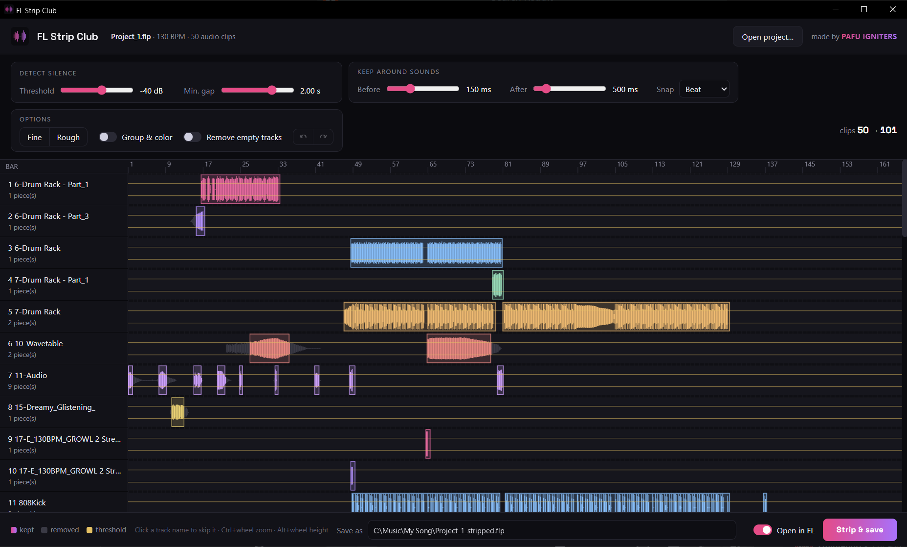

<p align="center"></p>

<h1 align="center">FL Strip Club</h1>

<p align="center"><b>Strip silence for FL Studio.</b> Your clips take it all off: only the silence goes.<br>Pro Tools-style strip silence for FL Studio's playlist.<br>
Cuts the empty stretches out of your audio clips. Every sound stays exactly where it was in the song.</p>



## What it does

You drop a saved FL Studio project (`.flp`) on the app. It shows every audio clip in your playlist with its waveform and, live as you turn the dials, where it would cut. Click **Strip & save** and it writes a new project next to yours (`<name>_stripped.flp`) with each clip split into pieces around the sounds. Your original project is never changed.

Also paints the mixer: with **Group & color** on, every mixer insert gets the same color as its channel and playlist track.

- **Sample-accurate**: each piece keeps its exact place on the timeline and in the audio file.
- **Live preview**: threshold, minimum gap, how much to keep before and after each sound, and snapping the cuts to the beat or bar.
- **Fine / Rough presets**: tight cuts, or coarse chops on the beat.
- **Group & color**: sorts tracks into Drums / Bass / Synths / Vocals / FX blocks, renames and colors them, mixer inserts included (handy for exported stems).
- **Remove empty tracks**: drops playlist tracks that turn out to be silent.
- **Skip a track**: click its name and it's left as it is.
- **Open in FL**: the new project opens in FL Studio when it's written.
- Reads WAV (16/24/32-bit and float), AIFF, FLAC, OGG and MP3.

## Install

**Windows**: download `FLStripClub-Setup-x.y.z.exe` from [Releases](../../releases) and run it. No admin rights needed. It adds a Start menu entry, an optional desktop shortcut, and an optional **Strip silence** item when you right-click a `.flp` file.

**macOS** (untested, feedback welcome): download `FLStripClub-mac-x.y.z.zip`, unzip it, then right-click `FL Strip Club.command` > **Open** (the first time macOS asks for confirmation). Needs Python 3 from [python.org](https://www.python.org/downloads/macos/); the first start sets itself up in about a minute.

## How to use

1. In FL Studio, **save** your project.
2. Open it in FL Strip Club (drop the `.flp` on the window, use **Open project…**, or right-click the file > **Strip silence**).
3. Turn the dials until the cuts look right. Shortcuts: Ctrl+wheel zoom, Alt+wheel track height, Ctrl+Z / Ctrl+Y undo / redo.
4. Click **Strip & save**. With **Open in FL** on, FL Studio loads the new project.

FL Studio's scripting can't cut playlist clips, so FL Strip Club works on the saved file instead of the open project. Save in FL before you open the project here.

## Limits

- Audio clips whose channel is **time-stretched or pitched** in FL are left as they are (the tool tells you which).
- Tested with FL Studio 2025 and 2026 projects (FL 20 and older should work but aren't tested).
- Audio files have to be where the project expects them.

## Command line

```
python strip_silence.py Project.flp [--db -50] [--gap 0.3] [--pad 0.01] [--tail 0.05] [--snap BEATS] [--rough] [--group] [--remove-blank]
```

## Building

```
pip install -r requirements.txt pyinstaller pillow
build.bat
```

Needs [Inno Setup 6](https://jrsoftware.org/isinfo.php). Output: `installer\Output\FLStripClub-Setup-*.exe` and `dist\FLStripClub-mac-*.zip`. Artwork: `brand\make_brand.py`.

## Credits

Made by **Mickey Perry**, aka **Pafu Igniters** (breakbeat, trance and drum & bass).
[SoundCloud](https://soundcloud.com/pafu) · [Bandcamp](https://pafu.bandcamp.com) · [motion design and animation](https://mickeyperry.github.io/)

MIT License.
